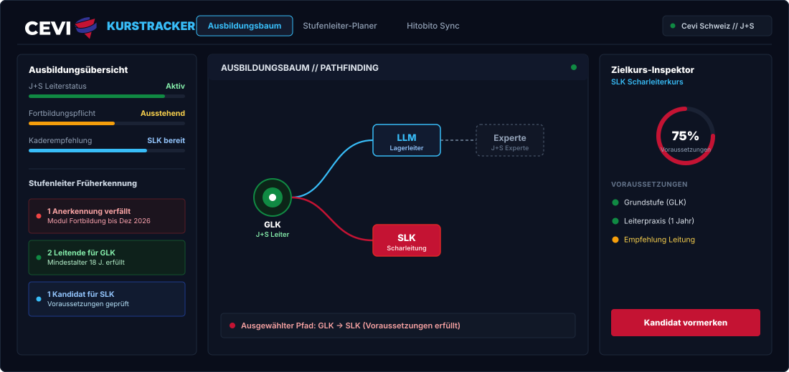



  Ausbildungs- und Kursmanagement für Schweizer Cevi-Leitende und Stufenleitungen.

  Interaktives Stufenleiter-Cockpit • J+S-Früherkennung • Hitobito Cevi-DB Vorbereitung

  <a href="#interface-vorschau" style="background: rgba(50, 51, 148, 0.25); border: 1px solid #38BDF8; color: #BAE6FD; padding: 6px 14px; border-radius: 20px; text-decoration: none; font-size: 12px; font-weight: 600; margin: 0 4px; display: inline-block;">Interface Vorschau</a>
  <a href="#schnellstart" style="background: rgba(196, 19, 51, 0.25); border: 1px solid #C41333; color: #FCA5A5; padding: 6px 14px; border-radius: 20px; text-decoration: none; font-size: 12px; font-weight: 600; margin: 0 4px; display: inline-block;">Schnellstart</a>
  <a href="#befehlsuebersicht" style="background: rgba(16, 138, 67, 0.25); border: 1px solid #108A43; color: #86EFAC; padding: 6px 14px; border-radius: 20px; text-decoration: none; font-size: 12px; font-weight: 600; margin: 0 4px; display: inline-block;">Befehle</a>
  <a href="#cevi-db" style="background: rgba(2, 132, 199, 0.25); border: 1px solid #0284C7; color: #7DD3FC; padding: 6px 14px; border-radius: 20px; text-decoration: none; font-size: 12px; font-weight: 600; margin: 0 4px; display: inline-block;">Cevi-DB</a>
  <a href="#ui-komponenten" style="background: rgba(50, 51, 148, 0.3); border: 1px solid #323394; color: #CBD5E1; padding: 6px 14px; border-radius: 20px; text-decoration: none; font-size: 12px; font-weight: 600; margin: 0 4px; display: inline-block;">UI Komponenten</a>

<!-- INTERFACE VORSCHAU CARD -->

  

    <h2 style="color: #FFFFFF; font-size: 20px; font-weight: 800; margin: 0; font-family: -apple-system, BlinkMacSystemFont, sans-serif;">Interface Vorschau</h2>
    DASHBOARD // MOCKUP
  

  

    
  

<!-- SCHNELLSTART CARD -->

  

    <h2 style="color: #FFFFFF; font-size: 20px; font-weight: 800; margin: 0; font-family: -apple-system, BlinkMacSystemFont, sans-serif;">Schnellstart</h2>
    

      Node.js v20+
      NPM v9+
    

  

  <!-- Schritt 1 -->
  

    SCHRITT 1 // SETUP
    <h3 style="color: #FFFFFF; font-size: 16px; margin: 10px 0 6px 0; font-family: -apple-system, BlinkMacSystemFont, sans-serif;">Repository Klonen &amp; Abhängigkeiten Installieren</h3>
    
Klont das Git-Repository lokal und installiert alle Pakete für Express und Motion.

    <pre style="background: #060914; border: 1px solid #1e293b; border-radius: 6px; padding: 12px 16px; color: #38BDF8; font-family: monospace; font-size: 13px; margin: 0; overflow-x: auto;"><code>git clone https://github.com/Sorry4Nothing/kurstracker.git
cd kurstracker
npm install</code></pre>
  

  <!-- Schritt 2 -->
  

    SCHRITT 2 // CONFIG
    <h3 style="color: #FFFFFF; font-size: 16px; margin: 10px 0 6px 0; font-family: -apple-system, BlinkMacSystemFont, sans-serif;">Lokale Umgebung Konfigurieren</h3>
    
Kopiert die Konfigurationsvorlage. Die Applikation läuft standardmässig im Cevi-DB Simulationsmodus mit Schweizer Testdaten.

    <pre style="background: #060914; border: 1px solid #1e293b; border-radius: 6px; padding: 12px 16px; color: #FCA5A5; font-family: monospace; font-size: 13px; margin: 0; overflow-x: auto;"><code># Windows (PowerShell / CMD):
copy .env.example .env.local

# macOS / Linux:
cp .env.example .env.local</code></pre>
  

  <!-- Schritt 3 -->
  

    SCHRITT 3 // RUN
    <h3 style="color: #FFFFFF; font-size: 16px; margin: 10px 0 6px 0; font-family: -apple-system, BlinkMacSystemFont, sans-serif;">Entwicklungsserver Starten</h3>
    
Startet den lokalen Express-Server mit automatischem Hot-Reload. Öffne anschliessend <b>http://localhost:3000</b> im Browser.

    <pre style="background: #060914; border: 1px solid #1e293b; border-radius: 6px; padding: 12px 16px; color: #86EFAC; font-family: monospace; font-size: 13px; margin: 0; overflow-x: auto;"><code>npm run dev</code></pre>
  

<!-- BEFEHLSÜBERSICHT CARD -->

  

    <h2 style="color: #FFFFFF; font-size: 20px; font-weight: 800; margin: 0; font-family: -apple-system, BlinkMacSystemFont, sans-serif;">Befehlsübersicht</h2>
    NPM SCRIPTS
  

  <!-- Row 1: npm run dev -->
  

    

      <code style="background: rgba(16, 138, 67, 0.2); color: #86EFAC; border: 1px solid #108A43; padding: 5px 12px; border-radius: 6px; font-family: monospace; font-size: 13px; font-weight: bold;">npm run dev</code>
      DEV WATCH
      PORT 3000
    

    Startet den Express-Server mit automatischem Hot-Reload (node --watch)
  

  <!-- Row 2: npm start -->
  

    

      <code style="background: rgba(50, 51, 148, 0.35); color: #BAE6FD; border: 1px solid #38BDF8; padding: 5px 12px; border-radius: 6px; font-family: monospace; font-size: 13px; font-weight: bold;">npm start</code>
      PRODUCTION
      PORT 3000
    

    Startet den Express-Server im Produktionsmodus
  

  <!-- Row 3: npm run test:tree -->
  

    

      <code style="background: rgba(196, 19, 51, 0.25); color: #FCA5A5; border: 1px solid #C41333; padding: 5px 12px; border-radius: 6px; font-family: monospace; font-size: 13px; font-weight: bold;">npm run test:tree</code>
      TEST SUITE
      100% PASS
    

    Führt Domain-Tests für Kursbaum, Mindestalter, Pfadfinder und J+S-Ampel aus
  

  <!-- Row 4: npm run env:check -->
  

    

      <code style="background: rgba(2, 132, 199, 0.25); color: #7DD3FC; border: 1px solid #0284C7; padding: 5px 12px; border-radius: 6px; font-family: monospace; font-size: 13px; font-weight: bold;">npm run env:check</code>
      DIAGNOSE
      CONFIG OK
    

    Validiert Umgebungsvariablen, Cevi-DB Modus und Konfiguration
  

<!-- CEVI-DB CARD (VOLL DURCHGESTYLT) -->

  

    <h2 style="color: #FFFFFF; font-size: 20px; font-weight: 800; margin: 0; font-family: -apple-system, BlinkMacSystemFont, sans-serif;">Cevi-DB (Hitobito) Schnittstelle</h2>
    REST API &amp; OAUTH 2.0
  

  <!-- Item 1: OAuth 2.0 Single Sign-On -->
  

    

      SSO AUTH
      <code style="background: #060914; color: #7DD3FC; border: 1px solid #1e293b; padding: 4px 10px; border-radius: 4px; font-family: monospace; font-size: 12px;">https://db.cevi.ch/oauth/authorize</code>
    

    Single Sign-On über offiziellen Cevi.DB Verbandslogin
  

  <!-- Item 2: Hitobito JSON:API v1.1 -->
  

    

      SYNC API
      <code style="background: #060914; color: #E2E8F0; border: 1px solid #1e293b; padding: 4px 8px; border-radius: 4px; font-family: monospace; font-size: 12px;">/api/events</code>
      <code style="background: #060914; color: #E2E8F0; border: 1px solid #1e293b; padding: 4px 8px; border-radius: 4px; font-family: monospace; font-size: 12px;">/api/qualifications</code>
      <code style="background: #060914; color: #E2E8F0; border: 1px solid #1e293b; padding: 4px 8px; border-radius: 4px; font-family: monospace; font-size: 12px;">/api/event_participations</code>
    

    Automatischer Kurs-, Teilnahme- und J+S-Statusabgleich
  

  <!-- Item 3: Service-Token -->
  

    

      SERVICE TOKEN
      <code style="background: #060914; color: #BAE6FD; border: 1px solid #1e293b; padding: 4px 10px; border-radius: 4px; font-family: monospace; font-size: 12px;">X-Token: &lt;secret&gt;</code>
    

    Direkter Abgleich für Ortsgruppen ohne interaktiven Benutzerlogin
  

  <!-- Config Hint Banner -->
  

    Produktivschaltung: CEVI_DB_CLIENT_ID und CEVI_DB_CLIENT_SECRET in .env.local eintragen und CEVI_DB_PREPARATION_MODE=false setzen.
  

<!-- UI KOMPONENTEN CARD (VOLL DURCHGESTYLT) -->

  

    <h2 style="color: #FFFFFF; font-size: 20px; font-weight: 800; margin: 0; font-family: -apple-system, BlinkMacSystemFont, sans-serif;">UI Komponenten</h2>
    EMBEDDED CODE
  

  <!-- Card 1: Ohne Build-Schritt -->
  

    

      OHNE BUILD
      <code style="background: #060914; color: #38BDF8; border: 1px solid #1e293b; padding: 3px 10px; border-radius: 4px; font-family: monospace; font-size: 12px;">public/</code>
    

    
Die Oberfläche ist reines HTML, CSS und JavaScript (ES-Module) und läuft ohne Build-Schritt. <b>Kein Token oder Registrierung für Klonen, Setup oder Weiterentwicklung erforderlich.</b>

  

  <!-- Card 2: Optionale Registry -->
  

    

      OPTIONALE REGISTRY
      <code style="background: #060914; color: #FCA5A5; border: 1px solid #1e293b; padding: 3px 10px; border-radius: 4px; font-family: monospace; font-size: 12px;">KOKO_PRO_TOKEN in .env.local</code>
    

    
Nur falls du <i>neue, zusätzliche</i> Komponenten aus der privaten Registry nachladen möchtest: <code style="color: #E2E8F0; background: #060914; padding: 2px 6px; border-radius: 4px;">npx shadcn@latest add @kokonutui-pro/&lt;name&gt;</code>.

  

  Entwickelt für Leiterinnen und Leiter der <b>Cevi Schweiz</b> • Kompatibel mit <b>Jugend+Sport (BASPO)</b>

