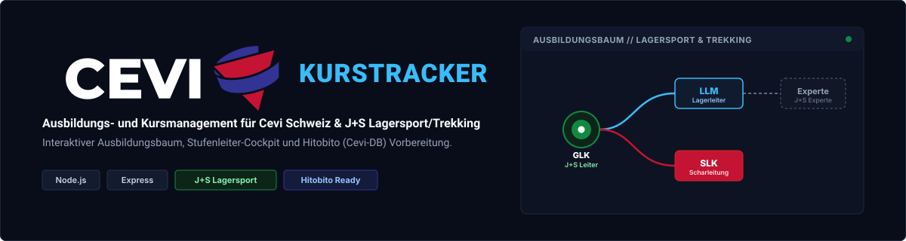
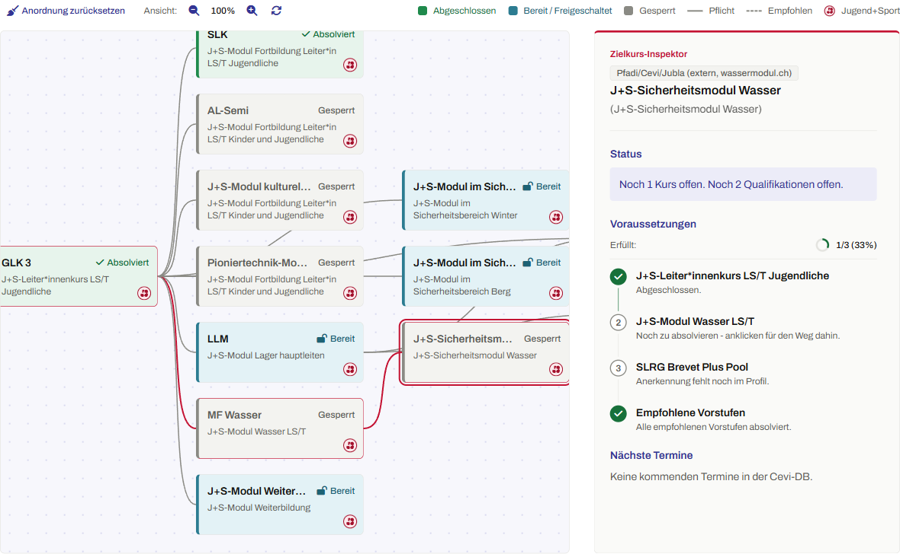

<div align="center">



**Ausbildung und Kursplanung für Cevi-Leitende und Stufenleitungen.**

</div>

Der Kurstracker zeigt Leitenden, welche Kurse sie schon haben, was als Nächstes ansteht und wann der nächste Kurs in ihrer Region stattfindet. Stufenleitende planen damit die Ausbildung ihrer Gruppe und halten ihre Kursvorschläge für das Jahr fest.

Es ist ein persönliches Projekt von Robin, zum Üben und Ausprobieren, und kein offizielles Angebot von Cevi Schweiz. Die App läuft heute im **Vorbereitungsmodus** mit erfundenen Testdaten. Die Anmeldung über die Cevi-DB (OAuth) ist gebaut und getestet, wartet aber noch auf die Freigabe einer OAuth-Applikation.



*Der Baum zeigt für jeden Kurs, ob er abgeschlossen, freigeschaltet oder gesperrt ist. Wählt man einen Zielkurs, markiert der rote Pfad den Weg dorthin, und rechts steht, was noch fehlt.*

## Was die App kann

- **Ausbildungsbaum:** die Kurse einer Region als Baum, mit Voraussetzungen, Mindestalter und empfohlenen Vorstufen. Ein Klick auf einen Zielkurs zeigt, was noch fehlt, und die nächsten Termine mit Anmeldeschluss und freien Plätzen. Das Kursangebot gibt es für die Regionen Zürich, Winterthur-Schaffhausen, Bern, Ostschweiz und AGSOLUZG.
- **Stufenleiter-Planer:** für Personen mit Leitungsrolle. Zeigt den Ausbildungsstand der eigenen Gruppe und lässt Kursvorschläge erfassen. Was jemand sieht, hängt von der Rolle ab (Abteilungs-, Stufen-, Froschli-Leitung).
- **Kursvorschläge:** alle Vorschläge einer Saison auf einen Blick, mit Status offen oder abgegeben.
- **Umgebungseinstellungen:** die Abteilungsleitung hinterlegt den Cevi-DB-Zugang ihrer Abteilung. Der Schlüssel liegt verschlüsselt in der Datenbank.
- **Systemlog** (Abteilungsleitung) und **API-Output** (nur lokal): technische Sicht auf Anfragen, Fehler und Kennzahlen.
- **Vier Farbschemas** (Cevi Klassik, Morgenrot, Sternennacht, Lagerfeuer), mobil nutzbar und mit Barrierefreiheits-Tests (WCAG 2.1 AA).

## Schnellstart

Voraussetzung: Node.js 20 oder neuer (die Tests laufen mit 24).

```bash
git clone https://github.com/Sorry4Nothing/kurstracker.git
cd kurstracker
npm install
cp .env.example .env.local     # Windows: copy .env.example .env.local
npm run dev
```

Danach `http://localhost:3000` öffnen. Im Vorbereitungsmodus brauchst du keine Anmeldung: Die App startet mit einem Demo-Profil (Abteilungsleitung) und Testdaten. Für Playwright einmalig `npx playwright install chromium`.

## Befehle

| Befehl | Was er tut |
| --- | --- |
| `npm run dev` | Server mit automatischem Neustart (`node --watch`) auf Port 3000 |
| `npm start` | Server ohne Neustart-Überwachung |
| `npm test` | Unit- und API-Tests (`node --test`): Kursbaum, Rollen, API, Sicherheit, Design-System |
| `npm run test:e2e` | Browser-Tests mit Playwright, inklusive Barrierefreiheit (axe), eigener Server auf Port 3100 |
| `npm run env:check` | prüft die Umgebungsvariablen und zeigt den Modus |

## Konfiguration

Alle Einstellungen stehen in `.env.local` (Vorlage: [.env.example](.env.example)). Wichtig:

| Variable | Bedeutung |
| --- | --- |
| `APP_ENV`, `APP_URL`, `PORT` | Umgebung (`local`, `development`, `production`), öffentliche Adresse und Port |
| `SESSION_SECRET` | Schlüssel für die Cookie-Signatur. In Produktion Pflicht, mindestens 32 Zeichen, nicht der Platzhalter |
| `CEVI_DB_PREPARATION_MODE` | `true`: Testdaten und Demo-Profil. `false`: echte Anmeldung über die Cevi-DB |
| `CEVI_DB_CLIENT_ID`, `CEVI_DB_CLIENT_SECRET`, `CEVI_DB_REDIRECT_URI` | Zugangsdaten der OAuth-Applikation |
| `CEVI_DB_SERVICE_TOKEN` | optional: lädt Kurse live auch im Vorbereitungsmodus. Nur lokal verwenden |
| `TRUST_PROXY`, `ALLOWED_HOSTS` | Betrieb hinter einem Reverse Proxy, zusätzliche erlaubte Host-Namen |
| `DATABASE_URL`, `CREDENTIAL_ENCRYPTION_KEY` | Postgres und AES-256-Schlüssel (64 Hex-Zeichen) für Kursvorschläge und Abteilungs-Zugänge. Ohne beide bleibt diese Funktion aus |

In Produktion verweigert der Start eine unsichere Konfiguration, zum Beispiel den Vorbereitungsmodus oder ein fehlendes Secret.

## Cevi-DB

Die Daten kommen aus der [Cevi-DB](https://db.cevi.ch) (Hitobito). Der Kurstracker liest nur und schreibt nichts zurück.

- **Anmeldung:** OAuth 2.0, Authorization Code mit PKCE (S256). Das Passwort sieht der Kurstracker nie.
- **Daten:** Profil, Rollen, Kurse, Kursteilnahmen und Qualifikationen über die JSON:API.
- **Stand:** Die OAuth-Applikation ist noch nicht freigegeben, deshalb läuft alles mit Testdaten. Wie die Umstellung auf Live aussieht, steht in [docs/CEVI_DB_INTEGRATION.md](docs/CEVI_DB_INTEGRATION.md).

## Tests und CI

- `node --test` deckt die Logik (Kursbaum, Mindestalter, Zulassung nach Jahrgang), die API samt Rechtematrix, Sicherheits-Härtung und das Design-System ab.
- Playwright testet die Oberfläche in vier Farbschemas und auf dem Handy und prüft jede Ansicht mit axe.
- GitHub Actions führt beides bei jedem Pull Request aus, dazu hält Dependabot die Abhängigkeiten aktuell.

## Aufbau

```
src/
  app.js          Express-App: Routen, Sitzungen, Sicherheits-Header
  config/         Umgebungsvariablen und deren Prüfung
  domain/         Kursbaum, Planer-Regeln, Rollen, Kursvorschläge (ohne Abhängigkeit von Express)
  services/       Cevi-DB-Client, Datenbank, Verschlüsselung, Systemlog
  views/          serverseitige Seiten (Anmelden, Fehlerseiten)
public/           Oberfläche in HTML, CSS und ES-Modulen, ohne Build-Schritt
test/  e2e/       Unit- und API-Tests, Browser-Tests
docs/             Dokumentation zu Betrieb, Cevi-DB, Übergabe und Git
```

Die Oberfläche braucht keinen Build: Dateien ändern, Seite neu laden. Das Frontend kommt ohne Inline-Skripte aus, damit die Content Security Policy nur eigene Skripte zulässt.

## Sicherheit

Der Kurstracker verarbeitet Personendaten von Leitenden. Darum gibt es unter anderem signierte, nicht auslesbare Sitzungs-Cookies mit Ablauf nach 8 Stunden ohne Aktivität, PKCE bei der Anmeldung, einen Schutz gegen Anfragen fremder Websites, eine Begrenzung der Anfragen, eine Host-Prüfung gegen DNS-Rebinding und ein Systemlog mit pseudonymisierten Akteuren. Eine Sicherheitslücke melde bitte privat, wie in [SECURITY.md](SECURITY.md) beschrieben.

## Dokumentation

| Dokument | Inhalt |
| --- | --- |
| [docs/CEVI_DB_INTEGRATION.md](docs/CEVI_DB_INTEGRATION.md) | Cevi-DB-Schnittstelle, Authentifizierung, Umstellung auf Live |
| [docs/BETRIEB.md](docs/BETRIEB.md) | Health-Check, Logs und Monitoring |
| [docs/UEBERGABE.md](docs/UEBERGABE.md) | was vor dem Go-live einzutragen und zu klären ist |
| [docs/GIT_WORKFLOW.md](docs/GIT_WORKFLOW.md) | Branches und Arbeitsweise |
| [SECURITY.md](SECURITY.md) | Sicherheitslücken melden |

## Mitarbeiten

Die Arbeit läuft über GitHub-Issues und ein Project-Board. Pro Issue gibt es einen Branch (`feature/<nr>-<name>` oder `fix/<nr>-<name>`) und einen Pull Request in `develop`, der das Issue mit `Closes #<nr>` schliesst. Direkt in `develop` oder `main` wird nicht gepusht.
